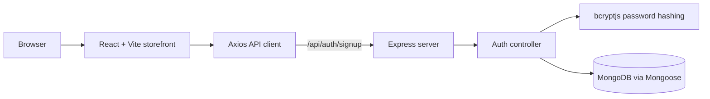

# E-Commerce Site

A clothing storefront project built with React and Tailwind CSS, with an Express and MongoDB backend foundation. The current work focuses on the storefront experience and user registration flow.

## Current Features

### Storefront UI

- Dark-themed home page.
- Navigation bar and hero section.
- Category bar and category carousel.
- Accessories and footwear product sections.
- Footer with store and newsletter information.
- React Router routes for the home, login, sign-up, and product detail pages.

### User Registration

- Sign-up form with name, email, and password fields.
- Frontend form state, loading feedback, and success/error messages.
- Express endpoint for account registration.
- Duplicate email check before account creation.
- Password hashing with bcryptjs before storing a user record.
- MongoDB connection through Mongoose.

> **Project status:** This repository is still in development. The login and product-detail routes are currently simple placeholders. The backend currently exposes the signup endpoint; product, cart, checkout, and login APIs are not yet implemented.

## Tech Stack

| Area | Technologies |
| --- | --- |
| Frontend | React, React Router, Vite |
| Styling | Tailwind CSS |
| HTTP client | Axios |
| Backend | Node.js, Express |
| Database | MongoDB, Mongoose |
| Security utility | bcryptjs |
| Middleware & configuration | CORS, dotenv |

## Architecture



## Project Structure

```text
E-Commerce-Site/
├── frontend/
│   ├── src/
│   │   ├── API/
│   │   │   └── axios.js
│   │   ├── Component/
│   │   ├── Pages/
│   │   │   ├── Home.jsx
│   │   │   ├── Login.jsx
│   │   │   ├── Sign_up.jsx
│   │   │   └── Products_details.jsx
│   │   ├── App.jsx
│   │   └── main.jsx
│   └── package.json
├── Backend/
│   ├── config/
│   │   └── db.js
│   ├── Controller/
│   │   └── authController.js
│   ├── Modles/
│   │   └── User.js
│   ├── routes/
│   │   └── authRoutes.js
│   ├── server.js
│   └── package.json
└── README.md
```

## Getting Started

### Prerequisites

- Node.js (LTS) and npm
- MongoDB database (local MongoDB or MongoDB Atlas)
- Git

### 1. Clone the repository

```bash
git clone https://github.com/Misam-Shaban/E-Commerce-Site.git
cd E-Commerce-Site
```

### 2. Start the frontend

Open a terminal:

```bash
cd frontend
npm install
npm run dev
```

Vite will print the local development URL in the terminal.

### 3. Configure and start the backend

Open a second terminal:

```bash
cd Backend
npm install
```

Create a `.env` file inside the `Backend` folder:

```env
PORT=5000
MONGO_URL=your_mongodb_connection_string
```

Then start the API:

```bash
npm start
```

The backend uses port `5000` by default and connects to MongoDB using `MONGO_URL`.

Keep your real database credentials in your local `.env` file. Never commit secrets to GitHub.

## Frontend Routes

| Route | Page | Current state |
| --- | --- | --- |
| `/` | Home | Storefront sections are assembled |
| `/sign-up` | Sign up | Form is connected to the signup API |
| `/login` | Login | Placeholder page |
| `/Products/:id` | Product details | Placeholder page |

## Backend API

The API base URL configured in `frontend/src/API/axios.js` is:

```
http://localhost:5000/api
```

### Register a user

```http
POST /api/auth/signup
Content-Type: application/json
```

Request body:

```json
{
  "name": "Your Name",
  "email": "you@example.com",
  "password": "your-password"
}
```

The server checks whether the email is already registered, hashes the password with bcryptjs, and creates the user record. It returns a success message when registration completes.

## Available Scripts

### Frontend

Run these commands from `frontend/`:

```bash
npm run dev
npm run build
npm run preview
npm run lint
```

### Backend

Run from `Backend/`:

```bash
npm start
```

## Next Development Goals

- Complete the login page and implement the login API.
- Connect product data to the backend.
- Build product listing and product detail functionality.
- Add cart and checkout workflows.
- Add authentication/session handling and route protection.
- Add screenshots captured from the running application.

---

Built by [Misam Shaban](https://github.com/Misam-Shaban).
